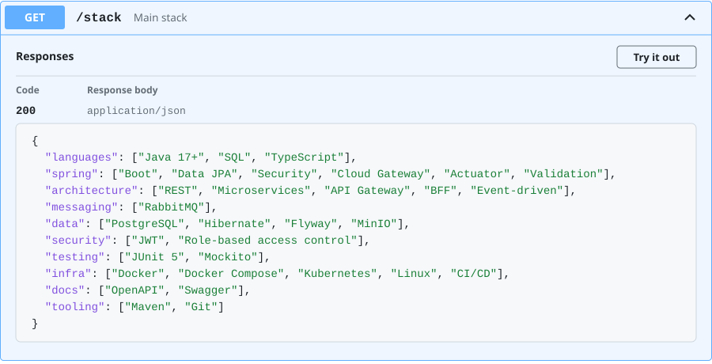

<picture>
  <source media="(prefers-color-scheme: dark)" srcset="assets/boot-dark.svg">
  
</picture>

 
 

<picture>
  <source media="(prefers-color-scheme: dark)" srcset="assets/api-dark.svg">
  
</picture>
<a href="https://www.linkedin.com/in/fernandoscarabeli/">
  <picture>
    <source media="(prefers-color-scheme: dark)" srcset="assets/api-about-dark.svg">
    
  </picture>
</a>
<picture>
  <source media="(prefers-color-scheme: dark)" srcset="assets/api-stack-dark.svg">
  
</picture>
<a href="https://github.com/FernandoScarabeli?tab=repositories">
  <picture>
    <source media="(prefers-color-scheme: dark)" srcset="assets/api-projects-dark.svg">
    
  </picture>
</a>
<a href="https://www.linkedin.com/in/fernandoscarabeli/">
  <picture>
    <source media="(prefers-color-scheme: dark)" srcset="assets/api-contact-dark.svg">
    
  </picture>
</a>
<picture>
  <source media="(prefers-color-scheme: dark)" srcset="assets/api-bugs-dark.svg">
  
</picture>

 
 

<picture>
  <source media="(prefers-color-scheme: dark)" srcset="https://raw.githubusercontent.com/FernandoScarabeli/FernandoScarabeli/output/pacman-contribution-graph-dark.svg">
  
</picture>
